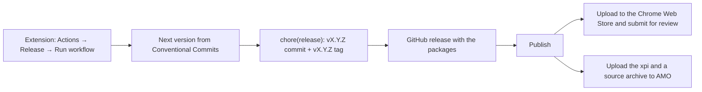

# webext-release

Release and store-publishing tooling for the casteroid browser extensions: version planning from Conventional Commits, commit checks, and uploads to the Chrome Web Store and Firefox Add-ons (AMO).



| Path | What it is |
|---|---|
| `.github/workflows/release.yml` | Reusable workflow: plan → package → commit and tag → GitHub release → publish |
| `.github/workflows/publish.yml` | Reusable workflow: uploads a release's packages to the stores; also called on its own to retry a tag |
| `plan/` | Action: works out the next version and, with `apply`, writes it into the manifest, `package.json` and `package-lock.json` |
| `lint-commits/` | Action: fails when a commit in the push or pull request does not follow Conventional Commits |
| `cws/` | Action: uploads a zip to the Chrome Web Store and submits it for review |
| `amo/` | Action: uploads an xpi and its source archive to AMO as a new listed version |
| `src/` | The TypeScript the actions run. No build step: Node 22.18 or newer runs it directly. |

## Using it in an extension

Pin every reference to a full commit SHA, with the tag in a comment. The callers pass store credentials in, so a moved tag would hand them to whatever the tag points at. Dependabot's `github-actions` ecosystem keeps the pins current.

`.github/workflows/release.yml`:

```yaml
name: Release

on:
  workflow_dispatch:
    inputs:
      bump:
        description: "Version bump: auto derives it from commits since the last tag"
        type: choice
        options: [auto, patch, minor, major]
        default: auto
      dry_run:
        description: "Dry run: only show the version and notes that would be released"
        type: boolean
        default: false

permissions:
  contents: read

jobs:
  release:
    permissions:
      contents: write
      id-token: write
    uses: casteroid/webext-release/.github/workflows/release.yml@<sha> # vX.Y.Z
    with:
      manifest: app/manifest.json
      check: npm run typecheck && npm test
      package: npm run package
      artifacts: packages/*
      chrome-package: "*.chrome.zip"
      firefox-package: "*.firefox.xpi"
      bump: ${{ inputs.bump }}
      dry-run: ${{ inputs.dry_run }}
    secrets:
      AMO_JWT_ISSUER: ${{ secrets.AMO_JWT_ISSUER }}
      AMO_JWT_SECRET: ${{ secrets.AMO_JWT_SECRET }}
```

`.github/workflows/publish.yml`, to retry the store uploads for an existing tag:

```yaml
name: Publish

on:
  workflow_dispatch:
    inputs:
      tag:
        description: "Release tag to upload to the stores, e.g. v0.2.0"
        type: string
        required: true

permissions:
  contents: read

jobs:
  publish:
    permissions:
      contents: read
      id-token: write
    uses: casteroid/webext-release/.github/workflows/publish.yml@<sha> # vX.Y.Z
    with:
      tag: ${{ inputs.tag }}
      chrome-package: "*.chrome.zip"
      firefox-package: "*.firefox.xpi"
    secrets:
      AMO_JWT_ISSUER: ${{ secrets.AMO_JWT_ISSUER }}
      AMO_JWT_SECRET: ${{ secrets.AMO_JWT_SECRET }}
```

In CI, after a checkout with `fetch-depth: 0` and `actions/setup-node`:

```yaml
      - uses: casteroid/webext-release/lint-commits@<sha> # vX.Y.Z
```

Notes on the inputs:

- An empty `chrome-package` or `firefox-package` skips that store. A store that is listed but not configured (see below) skips with a notice.
- `chrome-package` and `firefox-package` are `gh release download` patterns, so they must match the names of the files `artifacts` attaches to the release.
- Pass the AMO secrets by name, as above. A called workflow receives no secrets unless the caller passes them, and that includes environment secrets. Passing them by name works even though they exist only in the `firefox-add-ons` environment.
- Release only runs from `main`. It pushes the version commit and the tag to `main`, so branch protection must let GitHub Actions push there.

## How the version is chosen

`plan` looks at the commits since the last `vX.Y.Z` tag:

- any breaking change → major
- otherwise any `feat` → minor
- otherwise any `fix` or `perf` → patch
- otherwise nothing to release; the run fails and says so

The **bump** input overrides this (`patch`, `minor`, `major`). Before the first tag, the version already in the manifest is released unless a bump is given. **Dry run** prints the version and notes in the run summary and changes nothing.

The stores only accept a package whose version is higher than the last uploaded one, so never move or reuse a release tag.

## Store setup (once per extension)

### Chrome Web Store

Publish authenticates to the Chrome Web Store API as a Google Cloud **service account**, using **Workload Identity Federation**: GitHub's OIDC token is exchanged for a short-lived access token, so no key or refresh token is stored in GitHub.

A Chrome Web Store publisher can link only one service account. The casteroid publisher uses project `chrome-web-store-api-258321` (number `171512527082`), service account `cws-publisher` and pool `github`. A new extension reuses them and adds only its own provider and binding:

```sh
PROJECT_ID=chrome-web-store-api-258321
PROJECT_NUMBER=171512527082
REPO=casteroid/<extension-repo>
PROVIDER=<extension-repo>   # one provider per repository
SA=cws-publisher

gcloud config set project "$PROJECT_ID"

gcloud iam workload-identity-pools providers create-oidc "$PROVIDER" \
  --location=global \
  --workload-identity-pool=github \
  --issuer-uri="https://token.actions.githubusercontent.com" \
  --attribute-mapping="google.subject=assertion.sub,attribute.repository=assertion.repository" \
  --attribute-condition="assertion.repository == '$REPO'"

gcloud iam service-accounts add-iam-policy-binding "$SA@$PROJECT_ID.iam.gserviceaccount.com" \
  --role=roles/iam.workloadIdentityUser \
  --member="principalSet://iam.googleapis.com/projects/$PROJECT_NUMBER/locations/global/workloadIdentityPools/github/attribute.repository/$REPO"
```

The `repository` claim is the extension's repository even though the job is defined here, so the attribute condition names the extension.

<details>
<summary>Building the project, service account and pool from scratch</summary>

```sh
gcloud projects create "$PROJECT_ID"
gcloud config set project "$PROJECT_ID"
PROJECT_NUMBER=$(gcloud projects describe "$PROJECT_ID" --format='value(projectNumber)')
gcloud services enable chromewebstore.googleapis.com iamcredentials.googleapis.com sts.googleapis.com
gcloud iam service-accounts create "$SA" --display-name="Chrome Web Store publisher"
gcloud iam workload-identity-pools create github --location=global --display-name="GitHub Actions"
```

Then link the service account in the [Developer Dashboard](https://chrome.google.com/webstore/devconsole/): **Account**, add `cws-publisher@<project>.iam.gserviceaccount.com` under the service account section, and save.

</details>

Repository variables (none of them are secrets):

```sh
gh variable set CWS_PUBLISHER_ID --body "<Developer Dashboard → Account → Publisher ID>"
gh variable set CWS_EXTENSION_ID --body "<32-letter item ID>"
gh variable set GCP_WORKLOAD_IDENTITY_PROVIDER --body "projects/171512527082/locations/global/workloadIdentityPools/github/providers/<provider>"
gh variable set GCP_SERVICE_ACCOUNT --body "cws-publisher@chrome-web-store-api-258321.iam.gserviceaccount.com"
# Optional: STAGED_PUBLISH waits for you to press Publish in the dashboard after approval.
gh variable set CWS_PUBLISH_TYPE --body "DEFAULT_PUBLISH"
```

Until `CWS_EXTENSION_ID` is set, the Chrome job logs `CWS_EXTENSION_ID is not set` and skips.

### Firefox Add-ons (AMO)

Open <https://addons.mozilla.org/developers/addon/api/key/>, click **Generate new credentials**, and copy the JWT issuer and the JWT secret. The key belongs to the AMO account, so every add-on of that account can use the same pair.

```sh
gh api -X PUT "repos/casteroid/<extension-repo>/environments/firefox-add-ons"
gh secret set AMO_JWT_ISSUER --env firefox-add-ons   # paste the JWT issuer, e.g. user:12345678:123
gh secret set AMO_JWT_SECRET --env firefox-add-ons   # paste the JWT secret
gh variable set AMO_ADDON_ID --body "<browser_specific_settings.gecko.id from the manifest, or the AMO slug>"
```

Until all three are set, the Firefox job logs `AMO_JWT_ISSUER, AMO_JWT_SECRET or AMO_ADDON_ID is not set` and skips.

The xpi is a bundle, so AMO needs the source: the job uploads `git archive` of the tag with it. The extension's README must hold the build steps reviewers follow.

### Approvals

The Chrome job runs in the `chrome-web-store` environment and the Firefox job in `firefox-add-ons`. GitHub creates them on the first run. To approve every store submission by hand, add yourself as a required reviewer under **Settings → Environments**. The job waits for the approval even when the store is not configured.

## Troubleshooting

| Symptom | Cause and fix |
|---|---|
| Release fails with "nothing to release" | Only `docs`, `chore` and similar commits since the last tag. Pick a bump explicitly if you really want a release. |
| Release fails with "manifest says X but the last release tag is Y" | Someone changed the version by hand. Put the manifest and `package.json` back to the tag's version. |
| `git push` in Release is rejected | `main` moved while the workflow ran, or branch protection blocks the bot. Rerun; with branch protection, allow GitHub Actions to push to `main`. |
| Auth step fails with `Permission 'iam.serviceAccounts.getAccessToken' denied` | The `workloadIdentityUser` binding or the repository name in the provider's attribute condition is wrong. |
| Chrome upload returns 401 or 403 | The service account is not linked in the dashboard, or `CWS_PUBLISHER_ID` belongs to another publisher. |
| Chrome upload fails because of the version | A package with that version was already uploaded. Release again; the new version will be higher. |
| Chrome publish is refused while an item is in review | Wait for the review to finish, or cancel the pending submission in the dashboard, then run the extension's **Publish** with the tag. |
| Chrome publish is refused after you changed visibility in the dashboard | Publish once by hand from the dashboard; the API then works again. |
| Firefox job skips although the secrets are set | The caller does not pass `AMO_JWT_ISSUER` and `AMO_JWT_SECRET` under `secrets:`. |
| Firefox job fails with 401 on `POST .../addons/upload/` | `AMO_JWT_ISSUER` or `AMO_JWT_SECRET` is wrong or was revoked. Generate new credentials and set both secrets again. |
| Firefox job logs `AMO rejected the package` | The validation messages above it say what to fix in the manifest or the code. Release again after the fix. |
| Firefox job fails on `POST .../versions/` with "Version X already exists" | That version is already on AMO, for example after a manual upload. Nothing to do; the next release has a higher version. |

References: [Chrome Web Store API](https://developer.chrome.com/docs/webstore/using-api), [service accounts](https://developer.chrome.com/docs/webstore/service-accounts), [google-github-actions/auth](https://github.com/google-github-actions/auth), [AMO add-ons API](https://mozilla.github.io/addons-server/topics/api/addons.html), [AMO API authentication](https://mozilla.github.io/addons-server/topics/api/auth.html), [AMO source code submission](https://extensionworkshop.com/documentation/publish/source-code-submission/), [reusing workflows](https://docs.github.com/en/actions/how-tos/reuse-automations/reuse-workflows).

## Releasing this repository

Releases are `vX.Y.Z` tags created by hand on `main`; there is no moving major tag. A ruleset blocks deleting or moving `v*.*.*` tags.

```sh
git switch main && git pull
git tag -a vX.Y.Z -m vX.Y.Z
git push origin vX.Y.Z
```

Bump the major version when a caller has to change: a renamed or removed input, a new required input or secret, or different behaviour with the same inputs.

Commits follow [Conventional Commits](https://www.conventionalcommits.org/); CI checks them with this repository's own `lint-commits` action. `npm run typecheck`, `npm run lint` and `npm test` run the same checks as CI, except actionlint.
